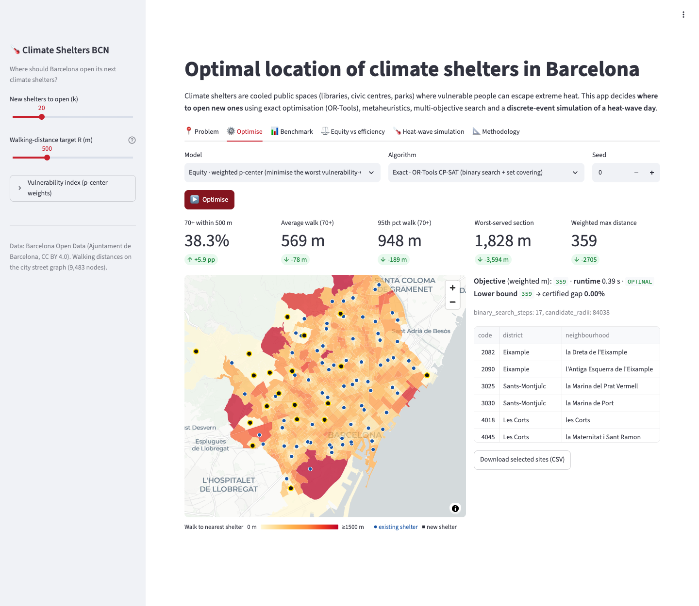
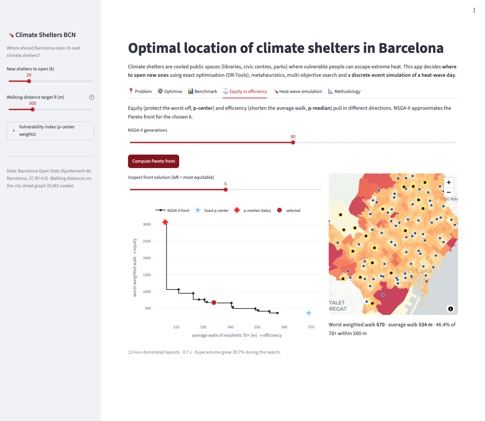
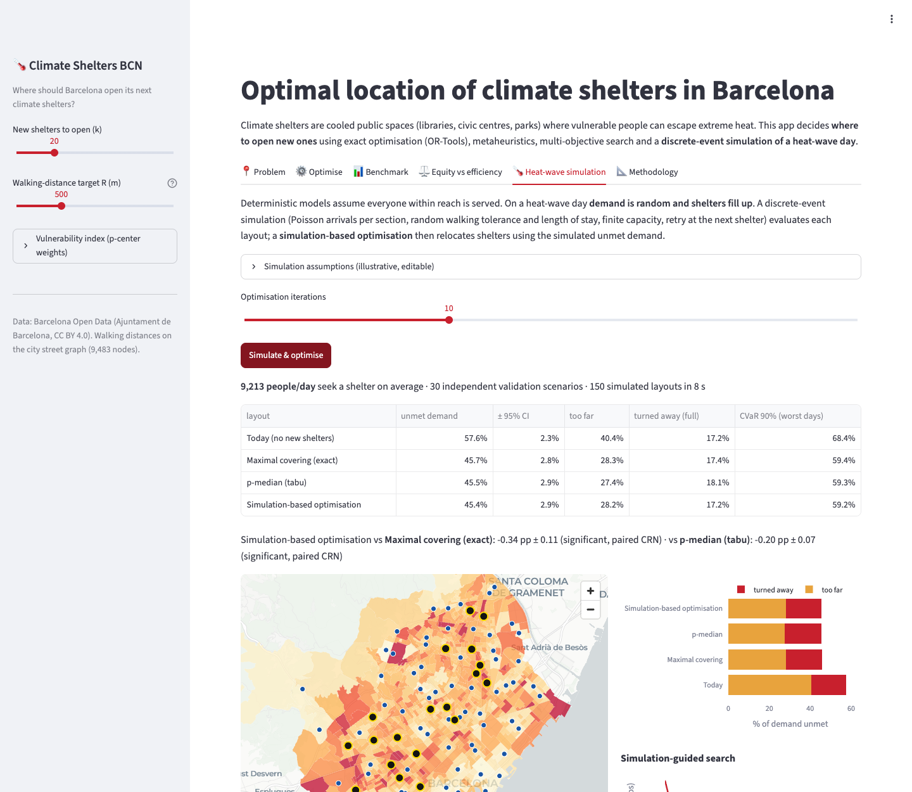

# Climate Shelters BCN: where should Barcelona open its next climate shelters?

[](https://github.com/Andresnico172/climate-shelters-optimizer/actions/workflows/ci.yml)
[](https://climate-shelters-optimizer-bcn.streamlit.app)


Decision-support app that locates new **climate shelters** (cooled public spaces for heat waves) for the
**233,545 residents aged 70+** of Barcelona. It combines **exact optimisation** (Google OR-Tools),
**metaheuristics** (tabu search, VNS, genetic algorithm), **multi-objective optimisation** (NSGA-II) and
**simulation-based optimisation** on a discrete-event model of a heat-wave day. The model runs on real open data
and real walking distances over the city street network.

**▶ Live demo:** https://climate-shelters-optimizer-bcn.streamlit.app



## Key results

| | Today (77 shelters) | +20 new shelters (exact p-center) |
|---|---|---|
| Residents 70+ within a 500 m walk | 32.4 % | 38.3 % |
| Average walk of residents 70+ | 647 m | 569 m |
| Worst vulnerability-weighted walk | 3,064 | 359 (−88 %) |

* **The first 10 shelters do most of the equity work.** They cut the worst vulnerability-weighted walk by 83 %. After that,
  returns diminish while coverage keeps rising almost linearly (exact optimum for k = 0…80 in the *Benchmark* tab).
* **Guaranteeing 500 m for every census section would need 201 new shelters, against 64 for 800 m.** Both figures are
  proven optimal with set covering. That is a concrete number for a budget discussion.
* **Equity and efficiency conflict.** With 20 new shelters, the p-median layout leaves the worst-off section exactly where it
  is today (3,064). The p-center layout fixes it, but the average walk is about 50 m longer (569 m against 516 m). NSGA-II maps
  the whole trade-off.
* **Capacity matters.** In the heat-wave simulation (~9,000 people a day seeking a shelter), one in six people is turned away
  from a full shelter. Simulation-based optimisation reduces unmet demand compared with both deterministic layouts. The
  difference is **statistically significant** on paired common-random-number scenarios.

## What is inside

| Technique | Implementation | Module |
|---|---|---|
| Data engineering | Open data → census sections, population 70+, heat-exposure grid, park distance; **Dijkstra walking distances** on the street graph (9,483 nodes) | `scripts/build_instance.py` |
| SQL | Tabular data in SQLite, loaded with SQL joins (portable to PostgreSQL / Azure SQL); runs logged to an `optimisation_run` table | `src/shelters/data.py` |
| Mathematical programming | **Weighted p-center, exact**: binary search over candidate radii with a **set-covering feasibility** model in **CP-SAT**. **Maximal covering** and **set covering** MIPs | `src/shelters/exact.py` |
| Lagrangian relaxation | p-median relaxation with subgradient optimisation: lower bound, Lagrangian heuristic, **certified gap** | `src/shelters/exact.py` |
| Metaheuristics | Greedy-Add, **Teitz–Bart interchange** (vectorised fast swap evaluation), **tabu search**, **VNS**, elitist **genetic algorithm** with spatial mutation | `src/shelters/heuristics.py` |
| Multi-objective | From-scratch **NSGA-II** (non-dominated sorting, crowding distance) with a **hypervolume** indicator | `src/shelters/multiobjective.py` |
| Discrete-event simulation | Heat-wave day: random temperature, Poisson arrivals, walking tolerance, length of stay, **finite capacity** with retry | `src/shelters/simulation.py` |
| Simulation-based optimisation | Simulation-guided swap search with **common random numbers**, selection of the best on independent scenarios, paired CIs, CVaR | `src/shelters/simulation.py` |
| Engineering | Package layout, 39 tests (exact solvers checked against **brute-force enumeration**), ruff, **GitHub Actions CI**, **Docker**, Streamlit Cloud | `tests/`, `.github/`, `Dockerfile` |

## Benchmark: metaheuristics against proven optima

Mean gap to the reference over 3 seeds, with mean runtime in brackets. The instance has 1,068 candidate sites and the 77
existing shelters are fixed. The references are the **CP-SAT optimum** for p-center and maximal covering (R = 500 m) and the
**Lagrangian lower bound** for p-median.

| Algorithm | p-center k=30 | p-center k=60 | covering k=60 | p-median k=60 |
|---|---|---|---|---|
| Greedy | 9.9 % (0.1 s) | 14.9 % (0.1 s) | 4.4 % (0.2 s) | 0.6 % (0.1 s) |
| Local search (interchange) | 6.5 % (0.4 s) | 7.4 % (1.1 s) | 1.7 % (1.1 s) | 0.2 % (0.5 s) |
| Tabu search | 6.4 % (2.0 s) | 4.0 % (3.8 s) | **0.7 %** (8.0 s) | **0.1 %** (3.7 s) |
| VNS | **1.5 %** (2.4 s) | **3.7 %** (4.6 s) | 1.7 % (5.0 s) | **0.1 %** (2.0 s) |
| Genetic algorithm | 6.5 % (0.6 s) | 6.7 % (1.3 s) | 2.3 % (1.1 s) | 0.3 % (0.8 s) |
| **Exact (CP-SAT)** | **0 %** (0.7 s) | **0 %** (1.5 s) | **0 %** (0.1 s) | gap ≤ 0.12 % (Lagrangian) |

At this scale a good formulation beats the metaheuristics. The textbook p-center MIP needs 1.1 M assignment variables, while
the binary-search reformulation solves the full instance to optimality in seconds. The metaheuristics are still worth having:
they are the only option when the objective is a black box. That is the case in the simulation-based optimisation, where the
"objective" is a stochastic simulation. Reproduce the table with `python scripts/benchmark.py`.

<table><tr>
<td></td>
<td></td>
</tr></table>

## Models

Existing shelters $E$ are always open. Choose a set $S$ of $k$ new sites among the census-section centroids, and let
$d_i(S)$ be the walking distance from section $i$ to its nearest open shelter.

* **Weighted p-center (equity):** $\min_S \max_i v_i\, d_i(S)$, where $v_i$ is a vulnerability index (share 70+, distance to park,
  summer heat), as in the original study plus heat exposure.
* **p-median (efficiency):** $\min_S \sum_i w_i\, d_i(S)$, where $w_i$ is the share of residents 70+.
* **Maximal covering (service level):** $\max_S \sum_i w_i\,[d_i(S)\le R]$.
* **Set covering:** the minimum number of shelters such that $d_i(S)\le R$ for every $i$.

The full formulations and algorithm details are in the app's *Methodology* tab.

## Run it

```bash
python -m venv .venv && source .venv/bin/activate
pip install -r requirements-dev.txt
streamlit run app/streamlit_app.py          # app on http://localhost:8501
pytest -q                                   # 39 tests, ~5 s
python scripts/build_instance.py            # optional: rebuild data/processed from data/raw
python scripts/benchmark.py                 # optional: regenerate data/results (~4 min)
```

With Docker:

```bash
docker build -t climate-shelters . && docker run -p 8501:8501 climate-shelters
```

**Deploy:** on [share.streamlit.io](https://share.streamlit.io) choose this repository, branch `main` and the file
`app/streamlit_app.py`. The same image runs on Azure Container Apps or App Service.

```
├── app/                    Streamlit UI (streamlit_app.py) and map/chart helpers (ui.py)
├── src/shelters/           optimisation library
│   ├── instance.py         instance + vulnerability index
│   ├── data.py             SQL data-access layer
│   ├── objectives.py       p-center / p-median / covering objectives and KPIs
│   ├── heuristics.py       greedy, interchange, tabu, VNS, GA
│   ├── exact.py            OR-Tools CP-SAT models + Lagrangian relaxation
│   ├── multiobjective.py   NSGA-II + hypervolume
│   └── simulation.py       discrete-event simulation + simulation-based optimisation
├── scripts/                ETL (build_instance.py) and benchmark
├── data/raw/               Barcelona open data
├── data/processed/         SQLite DB, distance matrix (.npz), GeoJSON
└── tests/
```

## Origin

This started as a team project at the **Barcelona Modelling Week (July 2025)**, on a challenge about climate shelters. The team
formulated a vulnerability-weighted p-center (age 70+ and distance to parks) and solved it with Gurobi on straight-line
distances between centroids. This repository is my re-engineering and extension of that work:

* **network walking distances** instead of Euclidean ones, which are 19 % longer at the median;
* existing shelters modelled at their **real coordinates**, plus **heat exposure** as a vulnerability criterion;
* open-source solvers, plus an **exact algorithm that scales to the full instance**;
* metaheuristics benchmarked against proven optima;
* multi-objective analysis;
* stochastic simulation of capacity, with simulation-based optimisation;
* a tested, deployable app.

## Limitations and next steps

* Demand points and candidate sites are census-section centroids. Real candidates would come from a list of feasible public
  buildings, which only means replacing the candidate columns of the distance matrix.
* The simulation parameters (share of people seeking a shelter, capacity, tolerance, length of stay) are **illustrative
  assumptions**, exposed in the app for what-if analysis. They are not calibrated against attendance data.
* Next steps: capacity decisions as variables (a capacitated location model) and opening hours. A fully stochastic
  two-stage model is another option.

## Data and license

Source data: [Open Data BCN](https://opendata-ajuntament.barcelona.cat), Ajuntament de Barcelona, CC BY 4.0. Datasets used:
census sections, population by age (Padró), climate-shelter network, summer thermal comfort, street graph. The code is under
the MIT License.
